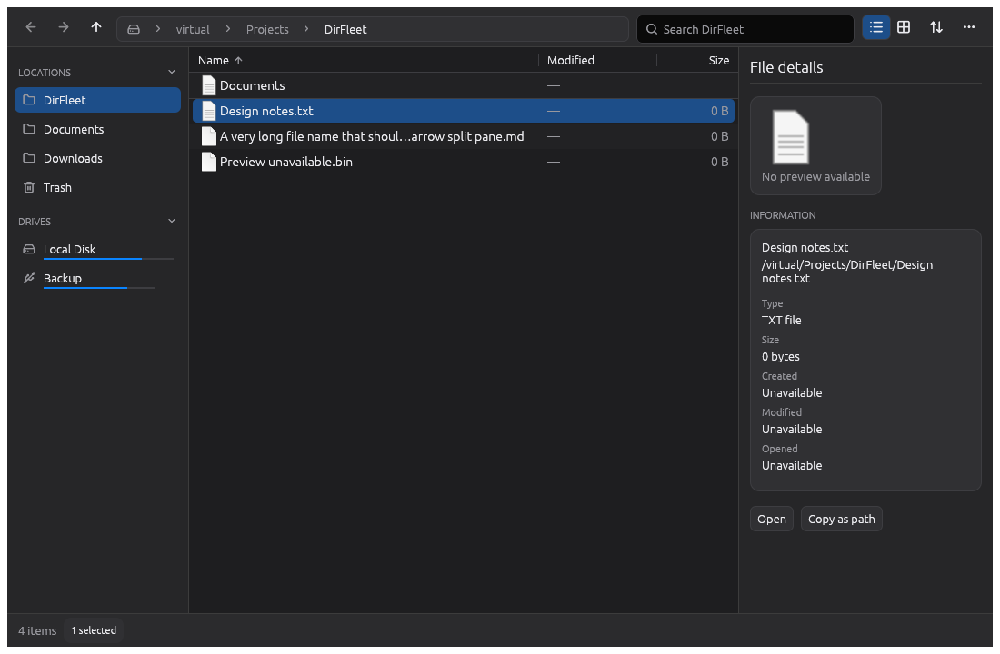

# lwa_fm

 

A (free) File Manager built with egui in Rust. Just a hobby, won't be big and ~~slow~~ professional like Finder or Windows Explorer.

## Configuration

There is no config file to edit by hand. Change settings in the app's Settings dialog, which has these pages: General, Appearance, Files & folders, Previews, Keyboard and Plugins. Each page except Keyboard and Plugins has a "Restore defaults" button.

Settings are saved automatically to `app.ron`. Settings missing from the file use their defaults.

### Command line and environment

| Name | Purpose |
| --- | --- |
| `--present-mode <mode>` or `LWA_FM_PRESENT_MODE` | The wgpu present mode: `fifo`, `mailbox`, `immediate` or `auto-no-vsync`. Any other value uses auto vsync, which is also the default. The flag takes priority over the variable. |
| `DIRFLEET_PLUGINS_DIR` | Use another plugins folder. See [docs/plugins.md](docs/plugins.md) for how plugins work. |

### File locations

Every folder is named after the app id, `io.github.leinnan.dirfleet`, shown below as `<id>`.

| What | Linux | macOS | Windows |
| --- | --- | --- | --- |
| Settings | `~/.local/share/<id>/app.ron` | `~/Library/Application Support/<id>/app.ron` | `%APPDATA%\<id>\data\app.ron` |
| Plugins | `~/.config/<id>/plugins` | `~/Library/Application Support/<id>/plugins` | `%APPDATA%\<id>\config\plugins` |
| Plugin data | `~/.local/share/<id>/plugin-data` | `~/Library/Application Support/<id>/plugin-data` | `%APPDATA%\<id>\data\plugin-data` |
| Downloaded FFmpeg | `~/.local/share/<id>/ffmpeg` | `~/Library/Application Support/<id>/ffmpeg` | `%LOCALAPPDATA%\<id>\data\ffmpeg` |
| Thumbnail cache | `~/.cache/<id>/thumbnails` | `~/Library/Caches/<id>/thumbnails` | `%LOCALAPPDATA%\<id>\cache\thumbnails` |
| Directory cache, open history and chosen thumbnails | `~/.local/share/<id>/dirs` | `~/Library/Application Support/<id>/dirs` | `%APPDATA%\<id>\data\dirs` |

Files in the folders older versions used are moved here at startup.

On Linux, `XDG_DATA_HOME`, `XDG_CONFIG_HOME` and `XDG_CACHE_HOME` replace `~/.local/share`, `~/.config` and `~/.cache` when set.

## Contributing

Please feel free to open a PR!

When I doubt what can be contributed take a look on GitHub Issues.

Please keep PRs (reasonably) small and scoped.

## Contributors

Development requires Rust 1.95 or newer. Windows uses Fluent styling with the system accent (read at startup), Segoe UI and Cascadia Mono when available, and native rounded window/caption styling. The saved System/Light/Dark appearance setting is preserved; light/dark changes apply live.
