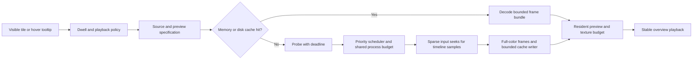

**Animated video thumbnails: analysis and implementation plan**

Prepared on 30 September 2026 from the working tree before implementation. The behavior and line references below describe that baseline. The fixes have since been implemented; see the [implementation report](thumbnail-implementation.md) and [new pipeline measurements](thumbnail-implementation-benchmark.json).

The main problem is the extraction algorithm. It asks FFmpeg to decode a long section of the source to obtain a tiny number of output frames. Resource limits and caching reduce the damage, but they do not change that underlying cost. The best first improvement is sparse input seeking, followed by full-color frame output and more reliable scheduling and display.

The requested product behavior is **a sequence of moments from across the whole video**. Preserve that behavior. A short motion loop is a different feature and should not replace the overview.

The existing design has useful foundations: asynchronous workers, separate video and image queues, bounded queues, hover priority, cancellation tokens for animations, source-revision cache keys, atomic cache writes, failure backoff, lazy texture uploads, and virtualized grid rows. Keep those capabilities while fixing the gaps described below.

The project is a Rust desktop file manager using eframe/egui with wgpu rendering. Directory loading and caching live in `dir_handling.rs` and `database.rs`, filesystem changes are handled by `watcher.rs`, and the asset pipeline lives almost entirely in `assets.rs`. The grid and tooltip code in `dock.rs` decide when to request previews. The relevant resolved versions in the local lockfile are egui 0.34.1, ffmpeg-sidecar 2.5.0, and image 0.25.10. The lockfile is currently ignored by Git, so dependency versions can differ between installations; that matters when comparing FFmpeg behavior and performance.

The current animation path works as follows:

1. A grid tile requests an animation immediately when hovered or when selected within a budget of four selected tiles per grid view. An open context menu also counts as hover. List view requests previews through a hover tooltip. See [preview policy](/Users/test/Documents/APPS/lwa_fm/src/app/dock.rs:604), [selected budget](/Users/test/Documents/APPS/lwa_fm/src/app/dock.rs:754), and [tile request](/Users/test/Documents/APPS/lwa_fm/src/app/dock.rs:1531).
2. `AssetManager` deduplicates by a string key containing path, modification revision, size, and animation version. It serves an in-memory animation or queues a job. The target display size and pixel density are absent from this request. See [animation request](/Users/test/Documents/APPS/lwa_fm/src/app/assets.rs:1275).
3. One dedicated preview worker loads a cached GIF or generates a new one. The video poster queue has another one or two workers, and image/system-icon work has another one to four. See [worker setup](/Users/test/Documents/APPS/lwa_fm/src/app/assets.rs:643).
4. On a cache miss, FFprobe obtains duration. FFmpeg seeks to 5% of that duration, processes a span of 85%, and uses an `fps` filter to output at most 12 frames, scaled into a 240-pixel box. It writes a GIF to stdout. See [generation](/Users/test/Documents/APPS/lwa_fm/src/app/assets.rs:2085).
5. Rust writes the GIF to disk, decodes its frames into RGBA, and assigns every video frame a 250 ms delay. The resulting overview loops in roughly three seconds. See [cache and decode](/Users/test/Documents/APPS/lwa_fm/src/app/assets.rs:2025) and [frame delays](/Users/test/Documents/APPS/lwa_fm/src/app/assets.rs:2185).
6. The UI uploads each frame into a separate texture the first time it is displayed. It retains both the RGBA frame and its texture, and schedules a repaint at the next frame boundary. See [animation rendering](/Users/test/Documents/APPS/lwa_fm/src/app/assets.rs:1337).

Static video posters follow a separate path: seek to one second, output one PNG through stdout, decode it in Rust, and persist a JPEG. Poster size comes from the icon size, rather than the dimensions of the tile. See [poster generation](/Users/test/Documents/APPS/lwa_fm/src/app/assets.rs:1908).

**The following findings are supported directly by the code.** Their impact on the user's real library still needs measurement with representative videos.

| Priority | Finding | Effect and proposed correction |
|---|---|---|
| P0 | Whole-span decoding for 12 output frames | `fps` drops decoded frames; it does not seek across the compressed input. Work grows with source duration, resolution, codec, and keyframe structure. Seek independently to sparse timeline positions instead. |
| P0 | Thread limits cover only part of FFmpeg | `-threads 1` appears before the input. Filter thread pools have separate controls, and output codec options should be scoped explicitly. Set input decoder, filter, and output encoder budgets; add a shared process budget across poster and animation queues. |
| P0 | Cancellation does not cover the complete operation | FFprobe uses blocking `Command::output()` without a deadline or token. FFmpeg preparation/download, cache reading, GIF decode, and GIF encode are also outside cooperative cancellation. A cancelled request can occupy the single preview worker before reaching the cancellable FFmpeg wait. Supervise every subprocess and check cancellation between bounded stages. |
| P1 | Queued priority cannot interrupt a running selected preview | Hover outranks selected jobs in the heap, but a selected job already running continues while it remains desired. The hovered item can wait for the current generation, whose timeout is 60 seconds. Make individual samples scheduling units so priority is reconsidered between samples. |
| P1 | Immediate hover and automatic selection generate excess work | Passing the pointer over tiles starts processes before intent is stable. Up to four selected entries per visible grid view can request generation, and an open menu triggers hover intent. Add hover dwell and a global playback/generation policy; retain selection highlighting independently of animation. |
| P1 | GIF is an unnecessary intermediate format for video | Video is converted to palette-based GIF and immediately decoded back to RGBA. The filter lacks a content-adapted `palettegen`/`paletteuse` stage. Palette quantization can damage gradients and fine detail. Use full-color frame output for video and a versioned compressed frame cache. |
| P1 | Animation memory accounting excludes GPU textures | `DecodedAnimation::byte_len()` counts only RGBA buffers. As playback visits frames, it also allocates textures. The nominal 64 MiB animation limit is not a combined memory limit. Track decoded CPU bytes and resident GPU bytes separately. |
| P1 | LRU byte counters miss capacity evictions | `put_texture()` and `put_animation()` use `LruCache::put()`, which returns a replaced value but does not return a different entry evicted by item capacity. Those bytes remain in the counter. Use `push()` and subtract every returned entry. Add invariant tests against actual cache contents. |
| P1 | Upload throttling can visibly replace an animation with a poster | When a frame texture is unavailable and upload is deferred, `render_animated_preview()` returns `Pending`; the grid draws the static fallback. Keep the previous animation texture visible while the next frame waits. Prioritize active preview uploads. |
| P1 | Upload time budget measures time since frame start | The two-millisecond check includes unrelated UI work between `begin_frame()` and rendering. It is not a measurement of texture upload cost. Track actual upload work and bytes; report GPU timing separately when available. |
| P1 | Poster resolution and animation resolution do not match display demand | Medium posters decode at 96 px but tiles are 168 points wide, with an approximately 148-point image area. Extra-large tiles have a 310-point image area but animated frames remain capped at 240 px. High-density screens magnify the mismatch. Pass target size and `pixels_per_point`, then select bounded resolution tiers. |
| P1 | Very short videos can produce no thumbnail | A fixed poster seek at one second misses videos shorter than that. Animation assumes at least a one-second duration; when probing fails, its 30-second fallback starts at 1.5 seconds, which can miss short clips. Clamp seeks to valid bounds and retry near the start. |
| P1 | Static poster scale limits width, not the longest edge | `scale='min(N,iw)':-1` allows portrait height to exceed N. This disagrees with the square bound used elsewhere and inflates memory for tall sources. Bound both axes and preserve display aspect ratio. |
| P1 | Cache cleanup runs only once per application process | The 512 MiB disk limit is checked after an idle interval through a `OnceLock`. Long sessions can grow beyond it afterward. Eviction orders by modification time, which represents creation/write time rather than recent use. Maintain size incrementally and prune periodically or after write thresholds. |
| P2 | Some stale-result races remain | File invalidation clears static `pending` state without cancelling the old job. Icon-size changes clear pending/failure caches while queues remain active. Results identify requests by key and navigation generation, without a unique attempt ID. An old result can interfere with a newer attempt using the same key. Use attempt IDs and per-source revisions when consuming results. |
| P2 | One active-directory generation is too coarse for visible dock panes | Navigation invalidates all results by one global generation, although multiple panes can remain visible. Focus changes can discard useful work or remove queued work for another visible pane. Track visible consumers and source identity separately from focus priority. |
| P2 | Probe metadata is incomplete and inconsistently keyed | Probe requests only container duration, ignores exit status, and does not validate finite positive values. Its cache key uses path and mtime, unlike animation keys that also use size. Probe a usable video stream, duration, rotation, sample aspect ratio, and color metadata with one shared revision key. Cache unavailable/failed results briefly to avoid repeated failed probes. |
| P2 | Frame and byte bounds are enforced too late | The four-MiB animation cache cap controls whether bytes are persisted, after stdout has already been collected. Cache reads and stderr collection are unbounded. GIF decode collects up to 120 full-resolution frames before reducing them. Enforce compressed-byte, dimension, frame-count, decoded-byte, and elapsed-time limits while reading and decoding. |
| P2 | GIF resampling loses elapsed time | For GIF sources, selecting 12 of up to 120 frames retains only the delays of selected frames, dropping time represented by skipped frames. A 20-frame GIF at 100 ms per frame becomes 12 frames at 100 ms, reducing its duration from two seconds to 1.2 seconds. Select by cumulative presentation time and accumulate skipped delays. Keep this distinct from video overview timing. |
| P2 | Color and geometry need explicit verification | There is no explicit HDR-to-SDR handling or normalization of sample aspect ratio in the thumbnail contract. Rotation may be applied by FFmpeg automatically, but there are no integration tests establishing the behavior. Verify rotated, anamorphic, limited/full-range, and HDR fixtures before adding conversion logic. |
| P2 | Errors lack useful classification | Three failures become permanent for that request in memory, whether the cause is an unsupported codec, missing tools, or a transient timeout. Poster stderr is discarded. Keep bounded diagnostics and distinguish unavailable backend, corrupt media, timeout, cancellation, and cache corruption. |

Two secondary lifecycle issues deserve small fixes during the scheduler work: workers have no shutdown protocol when an `AssetManager` is dropped, and repaint is requested before a result is sent. Publish first, then wake the UI; close schedulers and join owned workers during shutdown.

The cache accounting bug is particularly easy to miss. It occurs when the item-count limit evicts entries before the byte limit does. Typical large video animations may hit the byte limit first, but small animations and many small static textures expose the error. Repeated browsing can accumulate phantom bytes, shrink the effective cache, and cause repeated loading. The temporary result channel is also bounded by 64 messages rather than bytes; those messages can contain complete animations outside the resident-cache accounting.

At the current maximum, one square 12-frame animation occupies `12 × 240 × 240 × 4 = 2.64 MiB` of raw pixels. Fully uploaded textures add approximately another 2.64 MiB, before backend overhead and temporary copies. A cache holding close to 64 MiB of raw animation pixels can therefore have roughly another 64 MiB of GPU payload. Increasing frame count or resolution without correcting memory ownership would amplify this problem.

The overview currently changes frames four times per second and jumps between distant source moments. That temporal discontinuity is partly inherent in the requested overview behavior. Improving it should mean informative samples, consistent timing, and a stable image while loading; merely increasing frame rate would show the same jumps faster and consume more rendering resources.

**Controlled extraction measurements support the algorithm change.** The benchmark used local FFmpeg 8.1.1 on macOS, a synthetic H.264 video at 640×360 and 30 fps with two-second keyframes, and 60- and 600-second versions made by repeating a 20-second source using stream copy. Each method ran three sequential trials. The table reports median wall time and child CPU time; RSS is the highest per-process peak across those trials. For sparse seeks, time and CPU are summed over 12 sequential processes, and RSS is the largest individual process peak.

| Source duration | Method | Wall time | CPU time | Peak process RSS |
|---|---|---:|---:|---:|
| 60 s | Current whole-span GIF | 0.266 s | 0.292 s | 23.70 MiB |
| 60 s | Current GIF with filter/output threads capped | 0.265 s | 0.284 s | 20.52 MiB |
| 60 s | Whole-span RGBA, 12 frames | 0.266 s | 0.283 s | 20.61 MiB |
| 60 s | 12 independent seeks to RGBA | 0.270 s | 0.270 s | 19.97 MiB |
| 600 s | Current whole-span GIF | 2.430 s | 2.581 s | 25.03 MiB |
| 600 s | Current GIF with filter/output threads capped | 2.427 s | 2.574 s | 21.45 MiB |
| 600 s | Whole-span RGBA, 12 frames | 2.443 s | 2.587 s | 21.94 MiB |
| 600 s | 12 independent seeks to RGBA | 0.277 s | 0.274 s | 20.64 MiB |

The ten-minute overview was approximately **8.8× faster and used 9.4× less CPU time** with sparse seeks. The one-minute example was approximately equal in wall time because repeated process startup and seeking offset the decoding savings. This supports a duration-aware sampler: use bounded sequential extraction for short videos and sparse seeks for longer ones. Determine the crossover with representative codecs and keyframe intervals, rather than hard-coding the synthetic benchmark's crossover.

Removing GIF alone barely changed the one-minute extraction time, and capping filter threads mostly reduced process memory in this example. These are valuable improvements, but neither substitutes for changing the sampling algorithm. A three-second, 24-frame motion loop was also measured at approximately 0.034 seconds on either source duration; it shows why bounded decoding is cheap, but it does not meet the requested whole-video overview behavior.

Verbose FFmpeg diagnostics for the ten-minute whole-span RGBA extraction reported **14,684 decoded frames for 12 output frames**, with 14,671 frames dropped by the FPS filter. This directly confirms that reducing output frame rate does not avoid decoding the intervening video frames.

The benchmark excludes Rust GIF decoding, cache encoding/writing, queue wait, UI work, and GPU uploads. The repeated synthetic source has cheap decoding and good seeking; these results are not a promise of the same speedup on 4K HEVC, AV1, long-GOP, fragmented, damaged, or network-hosted files. See [raw measurements](/Users/test/Documents/APPS/lwa_fm/docs/analysis/thumbnail-benchmark.json).

Two focused checks also reproduced correctness issues: the current poster command returned zero bytes for a half-second clip, and a portrait source produced a 96×171 poster despite a 96-pixel target.

The recommended design has a small number of explicit contracts:

| Contract | Proposed contents |
|---|---|
| `SourceKey` | Normalized source path, nanosecond modification revision, file size, and source type. |
| `PreviewSpec` | Overview mode, sampling version, sample count, resolution tier, display delay, cache quality, and color policy. |
| `ProbeInfo` | Selected video stream, usable duration, geometry, rotation, aspect ratio, codec, and color metadata. |
| `RequestId` | Unique generation attempt; separate from reusable source/spec cache identity. |
| Preview state | Idle → waiting for dwell → queued → probing → sampling → ready; cancellation and classified failure are explicit outcomes. |
| Result validity | A result must match its attempt, source revision, and at least one current consumer before it changes live request state. |

The core pipeline becomes:

Start with 12 overview samples between 5% and 90% of a valid video duration, preserving the existing visual scope. The exact timestamp contract should be explicit, for example `t[i] = D × (0.05 + 0.85 × i / 11)`, clamped to available video timestamps. Unlike the current FPS filter, this includes an explicit final sample at the upper boundary. For very short clips, avoid repeated or out-of-range seeks and use a bounded sequential sampler. For unknown duration or non-seekable inputs, provide a limited beginning preview or poster rather than scanning indefinitely; acknowledge internally that it is not a whole-video overview.

Extract one frame per input seek, keeping processes sequential within the shared budget. This is easy to implement with the existing sidecar and benchmarked directly. Yield to the scheduler between samples so hovered work can take priority over selected and prefetched work. If process startup later becomes the main cost, evaluate a persistent decoder with native seeks as a separate phase; packaging and decoder complexity make that a larger change. Avoid opening 12 parallel decoder inputs merely to reduce process startup, because it can multiply memory and decoder work.

Use full-color output. A fixed-size raw RGBA frame has a simple, bounded read contract once output geometry is known. A PNG image pipe is another viable initial choice if avoiding geometry/framing complexity is more valuable than encode/decode cost. Normalize output dimensions and aspect ratio using the probed stream and test rotation behavior. Raw output is a transport, not the disk cache: 12 frames in the benchmark already occupied about 1.49 MiB, compared with roughly 55 KiB for the synthetic GIF.

Persist a versioned frame bundle containing a manifest and compressed JPEG frames for opaque video, initially benchmarking quality around 88–90. Store frame dimensions, source timestamps, playback delays, source/spec identity, frame lengths, and integrity data. Validate all lengths before allocation. Keep PNG or another lossless option for sources requiring alpha or lossless detail. The existing image library provides the required JPEG/PNG codecs; a new animation codec is unnecessary for the first implementation. A JPEG sprite sheet is an alternative if one decode and one texture atlas prove beneficial, but it increases the cost of partial loading and should be evaluated against per-frame storage.

Reuse an appropriate overview frame as the static poster when the overview exists. When only a poster is requested, generate it cheaply and let a later overview reuse that sample if timestamp and size match. A higher-resolution poster can serve smaller display tiers. Cache reads should not consume a video-process permit, and cache encoding should not block the hovered extraction lane.

Initially keep a roughly three-second overview cycle with stable per-sample delay. Do not add continuous crossfades by default: they would require many more UI repaints than the current discrete overview. Detect near-duplicate or blank samples using the already downscaled image, and allow a small, fixed number of alternative sample attempts per preview. Avoid a full-video scene-detection pass. Set quality thresholds from actual media examples before enabling them broadly.

For rendering, keep the most recently shown animation frame when another frame is awaiting upload. Allocate only active preview textures, release textures after a short inactivity grace period, and retain compressed cache entries for reuse. Benchmark one or two reusable frame textures against a bounded small atlas: reusable textures reduce GPU residency but require uploads when frames change; an atlas retains more pixels but can eliminate repeated uploads. Either design needs accounting for actual CPU and GPU ownership and global limits across visible panes. Increasing the entire warm cache's GPU allocation is not the first solution.

Proposed initial policy values are starting points for measurement:

| Setting | Starting value | Reason |
|---|---|---|
| Overview samples | 12 | Preserve coverage and bound startup/process cost. |
| Overview playback delay | 250–350 ms | Make distinct moments readable without continuous rendering. |
| Hover dwell | About 250 ms | Avoid generation during incidental pointer movement. |
| Active animations | One hovered preview by default; selected playback configurable | Prioritize user intent and cap redraw work across panes. |
| Concurrent video processes | One globally by default; evaluate two on faster systems | Bound combined poster and animation load. |
| Resolution tiers | Approximately 160, 240, 360, and 480 px, chosen from physical display demand | Improve large/high-density tiles while bounding pixel growth. |
| Probe deadline | About 2 s | A stalled probe must not monopolize preview generation. |
| Sample / overview deadlines | About 2 s per sample and 8 s total | Degrade to completed samples/poster instead of waiting a minute. |
| Decoded animation CPU / GPU budgets | Separate initial budgets, for example 32 MiB / 16 MiB | Count the resources that actually remain resident. |
| Disk cache budget | Preserve 512 MiB maximum and 384 MiB prune target initially | Fix enforcement before changing capacity. |

Resolution must also fit a per-preview decoded-byte limit. A 12-frame 480×480 overview is about 10.55 MiB before textures, so display demand alone cannot select quality without considering the global budget. Larger tiers should be reserved for active previews. The deadline and budget values should be tunable internally first; avoid filling the user interface with implementation controls.

Implement this in the following order, with each step independently reviewable:

1. **Establish measurement and fix low-risk correctness issues.** Add extraction/cache/queue/upload counters, attempt IDs, correct LRU accounting, exact source matching for invalidation, clamped short-video seeks, bounded portrait sizing, and bounded diagnostic collection. Publish results before repaint notification. Add regression tests for each behavior. This creates reliable measurements and stops avoidable cache churn.
2. **Bound generation and make priority effective.** Add a shared video-process budget and subprocess supervisor for both FFmpeg and FFprobe. Propagate cancellation through every stage. Add dwell, visibility consumers, global playback limits, and sample-level scheduling. Do not clear active jobs merely because display size changes; deduplicate by source/spec and retire consumers explicitly. Add worker shutdown. Verify rapid hover, selection, scrolling, navigation, and multi-pane behavior.
3. **Replace long-span GIF generation with sparse full-color sampling.** Preserve the requested whole-video overview, introduce the short-video sequential path, separate sample timestamps from display delays, reuse poster samples, and add progressive results. Obtain an early coarse overview using samples distributed across the timeline before filling the remaining positions. Write the new bounded cache format and version its keys. Retain old GIF caches as a transitional read path only if it simplifies rollout.
4. **Improve display quality and resident memory.** Pass target physical size to asset requests; choose quality within byte budgets. Keep the last shown frame during upload deferral. Add texture ownership/eviction and measure reusable textures versus an atlas. Verify rotation, aspect ratio, range conversion, HDR handling, and image detail on real clips. Correct original GIF timing and decode memory separately.
5. **Make cache lifecycle and failure recovery predictable.** Maintain disk size and recency, prune after write thresholds or idle intervals, remove abandoned temporary files, and invalidate old cache versions. Revalidate source revision before publication. Introduce classified retry policy and backend readiness/progress. Keep foreground decoding independent of maintenance and cache compression.

The first implementation should continue to use the existing Rust/egui application and FFmpeg sidecar. Native decoding and hardware acceleration are follow-up experiments when measurements justify them. Sparse software decoding is a simpler baseline, and hardware decoder startup, transfers, platform support, and driver behavior can offset benefits for individual frames.

Split the present `assets.rs` responsibilities while making these changes: retain an asset-facing facade, and move scheduler/process supervision, video probing/sampling, cache storage, and playback residency into focused modules. Extend the existing `MediaBackend` seam to cover probing and posters so tests can drive cancellation, deadlines, and failures without real subprocesses. Refactor alongside functional steps; a large preliminary rewrite would delay the main performance fix.

Measure application and child-process costs separately. Puffin scopes around generation capture elapsed worker time, not the child process's CPU usage. The current `FrameTracker` estimates render time from the interval between application frames minus application work; that interval also includes idle waiting, so it cannot establish actual GPU cost. Use direct upload/work timing and GPU instrumentation when available. Filesystem watchers already request repaints every 200 ms, which must be accounted for when measuring the extra repaint cost of animation.

Validation needs both deterministic tests and representative media:

| Area | Required evidence |
|---|---|
| Algorithm | Accurate sparse timestamps; output count bounded; decode work no longer proportional to full video duration for seekable inputs. Compare short sequential and sparse methods across codecs and GOP lengths. |
| Responsiveness | First poster time, first usable overview time, complete overview time, p50/p95 queue wait, and hover priority while selected generation is running. Separate dwell from extraction latency. |
| Resource use | Parent application RSS plus child RSS, total child CPU time, concurrent process count, decoded bytes in cache and result queues, GPU payload, and disk cache size. Include a long browsing session. |
| Cancellation | Cancel during probe, decode, read, cache encode, and upload; no stale result clears a newer request; no orphan process; next hovered item can begin promptly. |
| Playback | Stable last frame under upload pressure; correct overview delays; original GIF total timing preserved; no inactive preview repeatedly wakes the UI. |
| Geometry and color | Landscape, portrait, rotation metadata, anamorphic video, odd dimensions, very small sources, SDR gradients, screen recordings/text, limited/full range, HDR10, and HLG. |
| Sources and errors | Half-second clips, missing duration, variable frame rate, multiple video streams/cover art, long-GOP H.264/HEVC, AV1, corrupt files, missing tools, non-UTF-8 paths where supported, external disks, and network paths. |
| Cache | Cold/memory/disk hits, cache corruption, source changes during generation, capacity and byte-limit eviction, cache version changes, temporary-file cleanup, and continuous writes beyond the disk limit. |
| View behavior | Fast scroll, select-all, repeated hover, menu opening, icon-size change, split panes, focus switches, and inactive/minimized windows. |

Candidate acceptance criteria are: every subprocess honors cancellation and its deadline; concurrent video processes never exceed the configured global limit; counters match retained buffers/textures after every eviction; rapid incidental hover creates no generation work; an unchanged disk-cache hit starts no FFmpeg/FFprobe process; deferred uploads never return the tile to its poster; and cache size remains bounded through a long session. On a declared reference machine, target a usable warm preview within 150 ms after dwell and a coarse cold overview within one second on ordinary seekable 1080p sources. For long sources, target at least a threefold CPU reduction over the current algorithm while preserving informative timeline coverage. These are goals to validate, not results already demonstrated in the application.

The existing tests compiled successfully offline. Eleven relevant asset tests and the grid preview-policy test passed. They cover scheduler order and bounds, mock success/failure, cancellation state, failure backoff, and basic GIF downsampling. They do not exercise real video extraction, process interruption, memory accounting, GPU upload contention, or overview visual quality. Four asset tests that access the application's persistent thumbnail cache were not run during this review; the full application test suite and GPU snapshots were also not run. The compilation emitted existing warnings, including deprecated egui APIs and unused imports.

External behavior was checked against the primary documentation. FFmpeg documents that [the `fps` filter drops or duplicates frames](https://ffmpeg.org/ffmpeg-filters.html#fps), and that [input seeking decodes from the preceding seek point when accurate seeking is enabled](https://ffmpeg.org/ffmpeg.html#Main-options). Its [filter thread controls](https://ffmpeg.org/ffmpeg.html#Advanced-options) are separate from decoder/encoder options. If GIF were retained, [palette generation and application](https://ffmpeg.org/ffmpeg-filters.html#palettegen) would improve palette selection, but the sparse full-color design avoids introducing a more elaborate GIF conversion stage.

The first substantial performance change should therefore be sparse overview sampling, with cancellation and accurate budgets delivered alongside it. Quality improvements should follow the preserved overview behavior: better source moments, full-color frames, adequate resolution, and stable playback while work is deferred.
